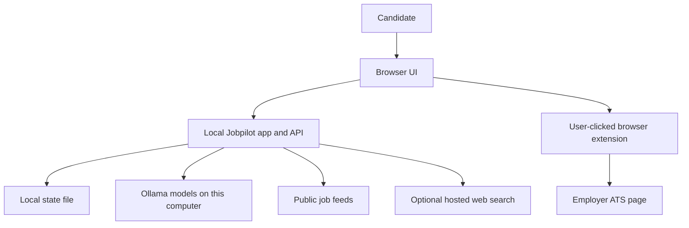
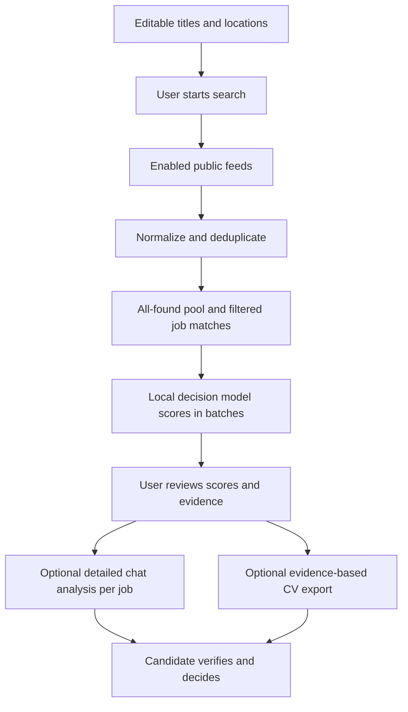
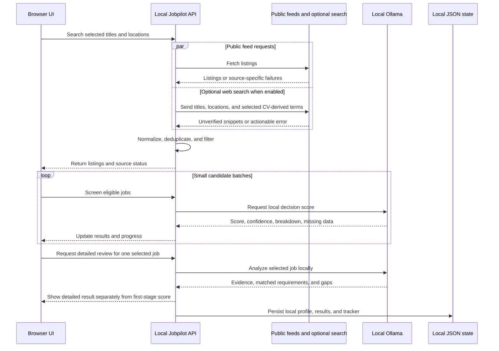
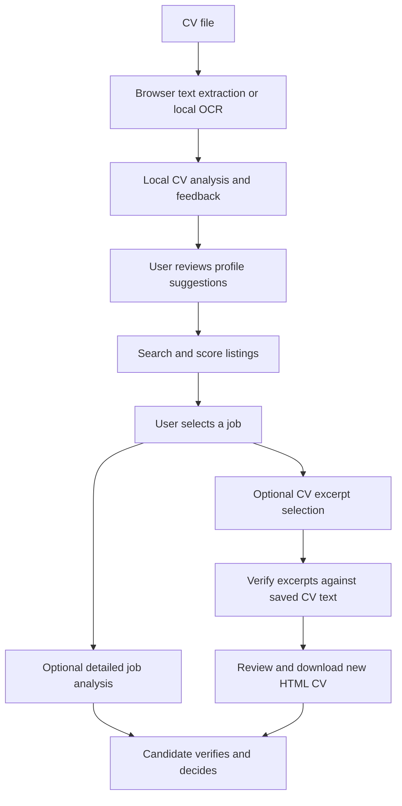

# Jobpilot

[](https://github.com/sinariazi/jobpilot/actions/workflows/ci.yml)

**A local-first job discovery and application-preparation workspace built with TypeScript, Next.js, and Ollama.**

Jobpilot helps a candidate move from CV to a focused job review: it searches public feeds, filters listings by editable role and location preferences, scores matches with a local decision model, and prepares evidence-based application material. The candidate reviews every result and remains responsible for applications.

> Portfolio project: demonstrates local AI orchestration, multi-source integration, progressive processing, evidence validation, and user-controlled automation. It is a personal tool, not a production hiring or recruitment platform.

## Product capabilities

- **CV analysis:** Extracts PDF, DOCX, and TXT files in the browser; optionally OCRs scanned PDFs locally with Tesseract. A local chat model summarizes the CV, suggests roles and skills, and gives evidence-based improvement feedback.
- **Job discovery:** Searches four public feeds—Arbeitnow, Remotive, Jobicy, and Himalayas—without provider API keys or registration. An optional Ollama Web Search integration can broaden discovery. Users can edit job titles and locations, inspect the locally retained discovery pool (up to 2,000 listings), and paste a posting missed by public feeds. The All found jobs view is paginated for responsiveness and includes listings that did not pass the title/location filters.
- **Progressive matching:** Shows title/location candidates before all scoring completes. Eligible listings are assessed in small batches with Ollama's `/v1/systemone` decision endpoint. Scores, confidence, category breakdowns, and missing evidence are displayed separately. “Potential fit” requires the configurable score and confidence cutoffs plus enough job evidence; low-confidence, missing-data, and snippet-only items stay visible as “Needs review.”
- **On-demand job analysis:** A local chat model runs only when the user requests a detailed review for one job. It returns matched requirements, gaps, and CV/job evidence without replacing the first-stage score.
- **CV and application preparation:** Selects exact CV excerpts for a chosen job, checks them against saved CV text, and exports a new editable, print-ready HTML file. Cover-letter drafts include a source-quote check. A local Chromium extension can prefill recognized empty ATS contact fields after a user click.
- **Local persistence and control:** Saves the profile, CV text excerpt, job pool, reviews, and tracker on the user's device. Jobpilot never submits applications.

## Architecture

### System context and privacy boundaries



The CV file is read in the browser and is not retained. A bounded extracted-text excerpt and analysis are saved locally so matching can resume later. CV and full job text used for analysis go from the local app to Ollama on the same computer. Public feeds receive no candidate data. If optional web search is enabled, only job-title and location queries go to its hosted API; CV text, skills, and full descriptions do not.

### Discovery and two-stage matching



The decision stage compares skills, experience, domain fit, and explicit disqualifier risk against available CV and job evidence. Its normalized 0–100 score is an estimate, not the probability of being hired. Confidence is separate from fit. The user can configure model, scoring weights, minimum score, and minimum confidence. The score alone does not establish a good match: missing information, low confidence, and search snippets are marked for review, and an on-demand detailed review can change the displayed fit verdict while preserving the first-stage score. Low-quality or missing source text is surfaced instead of being silently treated as a match.

The overview keeps title/location candidates separate from potential CV fits. Its sidebar count and fit-status filter show only jobs that clear the configured score, confidence, and evidence requirements; jobs needing review, not scored, or rated low remain available under their own filter. Provider counts refer to title/location candidates, not confirmed matches.

The detailed stage is user-triggered for one selected job; it does not run across the pool. This keeps the first pass responsive and avoids sending every listing through a slower chat model. The first-stage score remains intact beside the detailed analysis.

### Key design decisions

| Decision | Rationale | Trade-off |
|---|---|---|
| Run the app and AI locally | CV and job-match analysis remain on the user's computer; no hosted Jobpilot backend is required. | Job discovery still needs internet access; local model speed and quality depend on hardware and model choice. |
| Normalize feeds before filtering and scoring | One job type supports consistent deduplication, location/title filtering, UI display, and matching across providers. | Provider coverage, freshness, pagination, and access terms differ. |
| Keep the all-found pool separate from filtered matches | Users can inspect listings excluded by current preferences and adjust filters without hiding source results. | The unfiltered pool can contain irrelevant listings. |
| Use progressive batches and partial results | Listings appear before every model assessment finishes; one failed source does not erase successful results. | Scores and source counts can update over time. |
| Make detailed analysis explicit | The user chooses when a slower, evidence-oriented review is useful. | No detailed analysis is produced automatically during search. |
| Verify model-selected CV excerpts | Exact source checks reject model-invented CV lines before the draft is shown. | Source presence does not prove accuracy or relevance; edited text needs manual review. |
| Keep actions human-controlled | The user opens postings, checks evidence, edits drafts, and submits employer forms. | Jobpilot does not apply for jobs or answer screening questions. |

## Data sources and coverage

The four public feeds are free to query without API keys or registration. Their presence does **not** mean comprehensive Austrian coverage: several focus on remote roles or Germany/Europe. A successful search may return the same listings while provider data is unchanged or cached. Jobpilot keeps up to 2,000 normalized listings in its local discovery pool; the All found jobs tab shows that broader pool, with search, sorting, filter-status labels, and pagination. It is not a count of every current job published by the providers or on the internet.

| Source | Access and useful fields | Coverage and limits |
|---|---|---|
| [Arbeitnow](https://www.arbeitnow.com/api) | Public paginated JSON; title, company, location, remote flag, description, date, and link. | Primarily Germany with some Europe-wide jobs. No freshness guarantee is published. Jobpilot requests a bounded number of pages and links back to the source; access terms can change. |
| [Remotive](https://github.com/remotive-io/remote-jobs-api) | Public JSON; title, company, candidate location, job type, description, date, and link. | Remote roles, not local office coverage. Listings are delayed; Jobpilot caches responses and respects the provider's attribution and reuse limits. The API currently exposes an active result set rather than documented cursor pagination. |
| [Jobicy](https://jobicy.com/jobs-rss-feed) | Public JSON and location taxonomy; title, company, geo eligibility, description, date, and cursor. | Remote roles with country/region eligibility. The feed covers a rolling recent window and applies a publication delay. Jobpilot bounds region requests and caches results. |
| [Himalayas](https://himalayas.app/api) | Public search API; title, company, country/time-zone eligibility, description, date, and link. | Remote jobs. “Eligible in Austria” means the candidate may be located in Austria; it does not mean the employer is based in Vienna. Data refresh and request limits are provider-controlled. |

Jobpilot preserves source links and attribution, reports partial failures, and does not scrape pages behind access controls or login walls. It makes no claim that these feeds represent the full Austrian market. When a known posting is missing, the user can paste its description manually; an optional URL is retained as a reference and is not fetched.

### Optional web search

Ollama Web Search is off by default and requires an Ollama account and API key. When enabled, Jobpilot sends selected job titles, locations, and up to eight CV-derived skill/domain terms as query text. It never sends the CV text or full job descriptions to this search API. Each search round makes up to five sequential, varied queries and requests up to 10 snippets per query. The five queries vary their wording, role selection, and skill terms; clicking **Search jobs** again rotates to more query variants and adds newly discovered URLs to the local pool instead of replacing it. Repeated rounds may still return duplicates or stale pages because this API has no documented result-page cursor or offset.

Ollama documents up to 10 results per query. Free usage and availability can change, and no fixed Web Search quota is promised. More queries use more of the account's available usage and may be rate limited. See Ollama's [Web Search API documentation](https://docs.ollama.com/capabilities/web-search), [pricing](https://ollama.com/pricing), [terms](https://ollama.com/terms), and [privacy policy](https://ollama.com/privacy).

## Privacy, persistence, and user control

- The original CV file is not saved. Up to 10,000 extracted characters, analysis, and profile suggestions are saved in the local Jobpilot state file.
- Local state is stored in `~/.jobpilot/state.json` by default, or in `JOBPILOT_DATA_DIR` when configured. The directory/file use restrictive permissions on supported systems, but the contents are **not encrypted**.
- Local matching, CV analysis, detailed job analysis, CV tailoring, and AI cover-letter drafting use Ollama on loopback. Jobpilot has no hosted AI fallback.
- The optional hosted search API receives selected titles, locations, and up to eight CV-derived skills/domains as search terms; it does not receive CV text or full job descriptions. Public job feeds receive no CV or profile data.
- The CV tailoring export is a new HTML file downloaded by the browser. It does not overwrite the original CV or save the export on the Jobpilot server. Open it in a browser and use **Print / Save as PDF** if you need a PDF. It is not a direct DOCX or Canva export.
- AI-generated text and scores can be wrong. Review the source posting, every CV claim, and every exported document yourself. Jobpilot never applies or submits forms automatically.

## Run Jobpilot

### Quick start: one command

On **macOS or Linux**, open Terminal and paste:

```bash
curl -fsSL https://raw.githubusercontent.com/sinariazi/jobpilot/main/scripts/quickstart.sh | bash
```

On **Windows**, open PowerShell and paste:

```powershell
irm https://raw.githubusercontent.com/sinariazi/jobpilot/main/scripts/quickstart.ps1 | iex
```

The quick start downloads Jobpilot into `~/Jobpilot` (or `%USERPROFILE%\\Jobpilot` on Windows), installs Node.js if needed, asks before installing Ollama, downloads the suggested local models, installs the exact project dependencies, and starts the core app. It will not overwrite an existing project folder. To reuse an existing copy, run the script from that project folder. Optional features such as scanned-CV OCR and web search have separate setup steps below.

The first run needs internet access and several gigabytes of free disk space for the models. Ollama's installer may request administrator permission. Keep the terminal open while Jobpilot is running; open [http://localhost:3000](http://localhost:3000) after the server reports that it is ready. Press **Ctrl+C** in that terminal to stop the app.

The suggested models are `qwen3.5:4b` for CV analysis and detailed job reviews, and `tev1:0.8b` for quick first-stage scores. They do different work. You can choose other compatible installed models in **Local AI status**. To use different model tags with the quick-start scripts, set `JOBPILOT_CHAT_MODEL` and `JOBPILOT_DECISION_MODEL` before running the script.

### If you prefer to install manually

1. Install [Node.js 22.13 or newer](https://nodejs.org/) and [Ollama](https://ollama.com/download).
2. Download and extract the [Jobpilot repository](https://github.com/sinariazi/jobpilot) ZIP, or clone it with Git.
3. Open Terminal or PowerShell in the `jobpilot` folder and run:

   ```bash
   ollama pull qwen3.5:4b
   ollama pull tev1:0.8b
   npm ci
   npm run dev
   ```

4. Keep Ollama and the terminal running. Open [http://localhost:3000](http://localhost:3000).

Ollama 0.35 or newer is needed for the `/v1/systemone` decision endpoint. Jobpilot reports unavailable models and provider failures rather than silently switching to hosted AI.

### 3. Add a CV and search

1. Open **Candidate profile** and upload a PDF, DOCX, or TXT CV.
2. Review the CV summary, suggested titles, and skills. Jobpilot refreshes listings after extracting the CV and again if local analysis changes the suggested titles.
3. Confirm or edit job titles and preferred locations. Click **Search jobs** whenever you want to refresh. Listings appear as they are found; local scores are calculated in batches.
4. Select a job to inspect its description and source link. Request **Analyze this job in detail** when you want a local evidence review. Use **Tailor CV** to create a reviewable, role-focused draft from exact CV excerpts.
5. Save, track, and prepare applications yourself. Jobpilot does not submit applications.

Public feeds may return the same listings until their data or cache refreshes. Use **Load more jobs** where a source provides pagination. If Ollama or a source fails, Jobpilot reports it and preserves available listings.

**If a detailed job review stops at the output limit:** Jobpilot now requests a constrained JSON response and retries once with a shorter CV/job excerpt. If the retry also fails, select a smaller installed chat model with a larger context window in **Local AI status**. Search-result snippets are incomplete; open the original posting or add its full description before relying on the evidence review.

### Optional setup

**Wider web search:** Create an Ollama Web Search API key, copy `.env.example` to `.env.local`, set `OLLAMA_API_KEY=your-key`, restart Jobpilot, and enable **Also search the web**. Do not commit `.env.local`. The API key is only used for this optional discovery source.

**Scanned CV OCR:** Install Tesseract and language data on the same computer. For macOS with Homebrew:

```bash
brew install tesseract tesseract-lang
```

Restart Jobpilot and choose English, German, or both in the CV upload section. OCR is processed locally; temporary page images are deleted after recognition. Text-based CVs need no OCR installation.

**ATS form prefill (Chrome/Edge):** Keep Jobpilot running at `localhost:3000`; open `chrome://extensions` or `edge://extensions`; enable **Developer mode**; choose **Load unpacked**; select the repository's `extension/chromium` folder. On a supported ATS, use the extension's **Fill empty fields** action. It only fills recognized blank fields, does not upload CVs or answer screening questions, and never submits the form.

## Developer setup

Requirements: Node.js 22.13+ and npm. Use `npm ci` to install the exact dependencies recorded in the lockfile.

```bash
npm ci
npm run dev
```

Verification commands:

```bash
npm run lint
npm run typecheck
npm test
npm run build
```

The automated suite uses mocked provider fixtures and does not depend on live feeds. GitHub Actions runs lint, typecheck, tests, and build on pushes and pull requests. Do not commit CVs, personal search data, credentials, or `.env.local`.

### Implementation stack

- **Application:** Next.js 16, React 19, TypeScript
- **CV extraction:** PDF.js and Mammoth; optional local Tesseract OCR
- **AI orchestration:** Ollama chat API and Ollama `/v1/systemone`
- **Persistence:** Local JSON state with validated reads and atomic writes
- **Testing:** Vitest and GitHub Actions

## Current limitations

- No comprehensive Austria-wide job feed is available under the current no-key/no-registration constraints. Results are useful but incomplete and weighted toward remote and Germany/Europe listings.
- Decision-score error rates and calibration have not been established. The UI collects local human feedback, but a held-out, varied human-reviewed evaluation set is still needed.
- The score/confidence cutoffs are transparent triage rules, not empirically calibrated thresholds. A “Potential fit” label still needs candidate review; detailed analysis can disagree.
- Local state is not encrypted. Protect the device and backups; encryption remains unfinished.
- A full screen-reader and cross-browser accessibility audit has not been completed.
- End-to-end tests against live job searches, profile workflows, and supported ATS pages remain outstanding.
- CV export is print-ready HTML; direct DOCX generation and Canva integration are not implemented.

## Solution architecture showcase

This section summarizes the implementation choices relevant to a systems-design review: clear data boundaries, provider adapters, asynchronous partial-result handling, explicit model routing, and user-controlled actions.

### Runtime and failure handling



### CV and application evidence flow



### Example design decisions and risks

| Area | Design | Risk controlled | Remaining risk |
|---|---|---|---|
| Provider integration | Per-source adapters normalize to a shared job model; pagination and source status stay explicit. | Provider failures and schema differences are isolated; partial results remain usable. | Provider terms, fields, availability, and freshness can change. |
| Model routing | Decision endpoint for fast batch scores; chat endpoint only for user-requested, per-job analysis. | Avoids sending the whole candidate pool through slower detailed analysis. | Local models can misread evidence or return malformed output. |
| CV evidence | Model-selected excerpts must match the saved CV text before display/export. | Blocks unsupported CV statements from the initial draft. | Exact text presence does not validate truth, context, or relevance; edits require review. |
| Persistence | Validate local state and write atomically to a per-user directory. | Avoids partial writes and rejects malformed persisted state. | Local files are not encrypted and are only as safe as the device and backups. |
| User actions | Explicit search, detailed-review, export, and ATS-prefill actions. No automatic submission. | Keeps consequential decisions with the candidate. | Candidate must verify job availability and complete employer-specific requirements. |

**Engineering caveat:** First-stage scores are estimates rather than hiring probabilities. No calibration claim is made without a real human-reviewed evaluation set. Public-source coverage, especially for Austrian office-based jobs, is incomplete.
